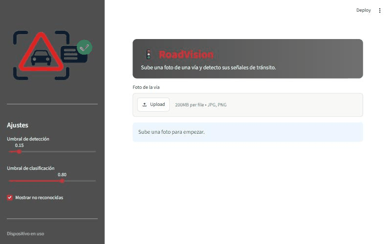
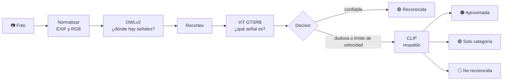
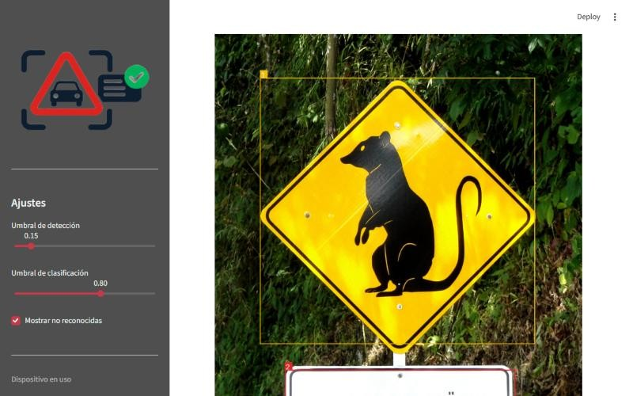
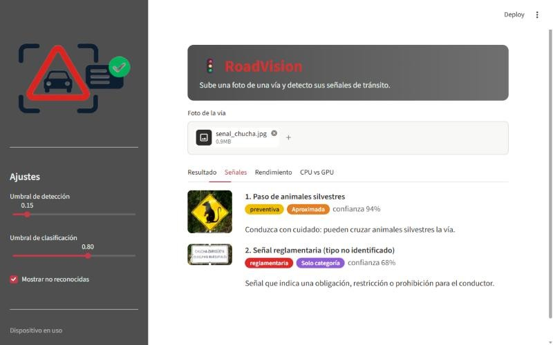
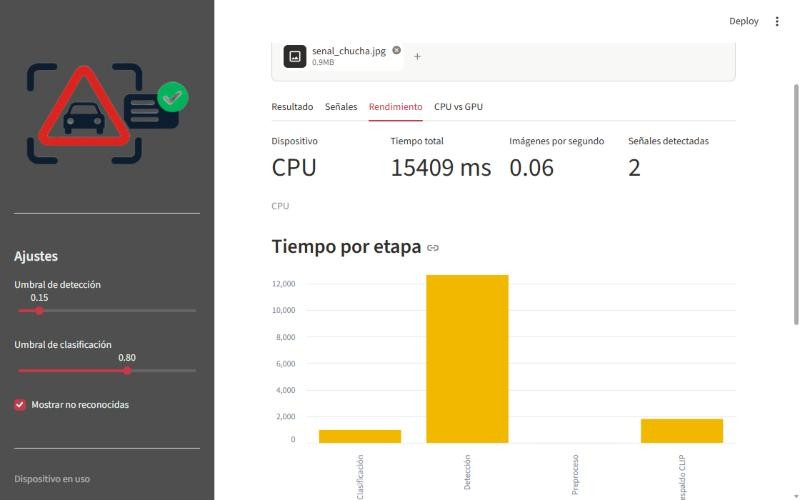
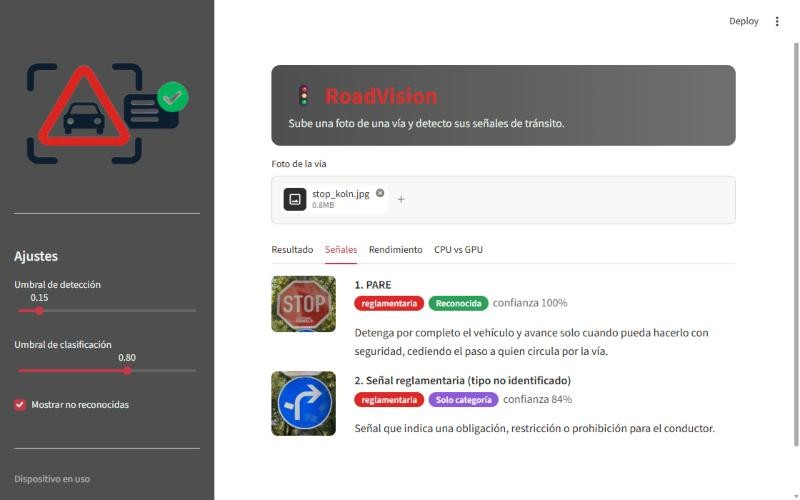

<div align="center">


# RoadVision

**Sube una foto de una vía y RoadVision encuentra sus señales de tránsito, las clasifica y te explica qué significan.**

[](https://www.python.org/)
[](https://pytorch.org/)
[](https://huggingface.co/docs/transformers)
[](https://streamlit.io/)
[-76B900?logo=nvidia&logoColor=white)](https://developer.nvidia.com/cuda-toolkit)
<br>
[](LICENSE)
[](#pruebas)
[](https://github.com/DeimonBot/TrafficSigns/graphs/contributors)
[](https://github.com/DeimonBot/TrafficSigns/commits/main)



<sub>Demostración en CPU con una señal colombiana de paso de fauna. Foto: <a href="https://commons.wikimedia.org/wiki/File:Chucha_crossing_warning_sign.jpg">Germarquezm</a>, CC BY-SA 3.0.</sub>

</div>

---

## Contenido

- [¿Qué hace?](#qué-hace)
- [Capturas](#capturas)
- [Instalación paso a paso](#instalación-paso-a-paso)
- [Cómo se usa](#cómo-se-usa)
- [Estructura del proyecto](#estructura-del-proyecto)
- [Modelos](#modelos)
- [Ajustes que hicimos](#ajustes-que-hicimos)
- [Resultados y limitaciones](#resultados-y-limitaciones)
- [Licencia](#licencia)
- [Equipo](#equipo)
- [Créditos](#créditos)

## ¿Qué hace?

1. **Carga una foto** de una calle o carretera (JPG o PNG; corrige la rotación de las fotos de celular).
2. **Detecta** dónde hay señales de tránsito.
3. **Clasifica** cada señal y la asocia a un catálogo de señales colombianas.
4. **Explica** su significado en español.
5. **Resume** cuántas señales hay por categoría y **mide** el tiempo de cada etapa en CPU o GPU.

La regla de oro del proyecto: **es preferible decir "no la reconozco" que dar un nombre equivocado con seguridad.** Por eso cada señal sale con un estado:

| Estado | Qué significa |
|---|---|
| 🟢 **Reconocida** | El clasificador la identificó con confianza y tiene equivalente colombiano. |
| 🟠 **Aproximada** | La identificó el modelo de respaldo (CLIP); se muestra como aproximada. |
| 🟣 **Solo categoría** | Se sabe si es reglamentaria, preventiva o informativa, pero no cuál exactamente. |
| ⚪ **No reconocida** | No hay suficiente certeza para decir qué es. |



## Capturas

| Resultado | Señales | Rendimiento |
|:---:|:---:|:---:|
|  |  |  |
| La señal queda marcada con el color de su categoría. | Cada señal con su recorte, estado, confianza y significado. | Tiempo total y por etapa (aquí en CPU). |

<p align="center">
  <br>
  <sub>Señales tipo europeo: PARE reconocido al 100 % y la flecha azul clasificada como reglamentaria. Foto: <a href="https://commons.wikimedia.org/wiki/File:GER_K%C3%B6ln,_C%C3%A4cilienstra%C3%9Fe_001.jpg">-wuppertaler</a>, CC BY 4.0.</sub>
</p>

## Instalación paso a paso

**Requisitos:** Python 3.11 o 3.12, Git y unos 4 GB libres (PyTorch, ~1,5 GB de modelos y datos). Una GPU NVIDIA es opcional: sin ella todo funciona en CPU, más lento.

> Consejo: clona el proyecto en una carpeta que no esté sincronizada con OneDrive, Google Drive o Dropbox.

**1. Clonar el repositorio**

```bash
git clone https://github.com/DeimonBot/TrafficSigns.git
cd TrafficSigns
```

**2. Crear y activar un entorno virtual**

```bash
python -m venv .venv
# Windows (PowerShell): .venv\Scripts\Activate.ps1
# Linux / macOS:        source .venv/bin/activate
```

**3. Instalar PyTorch** (va aparte porque depende de tu hardware)

- Sin GPU NVIDIA:

  ```bash
  pip install torch torchvision --index-url https://download.pytorch.org/whl/cpu
  ```

- Con GPU NVIDIA: elige tu variante de CUDA en el selector de [pytorch.org](https://pytorch.org/get-started/locally/) y ejecuta el comando que indica.

**4. Instalar el resto de dependencias** (listadas en [`requirements.txt`](requirements.txt))

```bash
pip install -r requirements.txt
```

**5. Descargar los modelos** (una sola vez; quedan en la caché de Hugging Face)

```bash
python scripts/download_models.py
```

**6. Comprobar la GPU** (opcional; termina con código 0 si PyTorch ve CUDA)

```bash
python scripts/check_gpu.py
```

Para el PC con GPU NVIDIA hay una guía completa de instalación y verificación, pensada para que la ejecute un asistente: [docs/guia-pc-nvidia.md](docs/guia-pc-nvidia.md).

## Cómo se usa

### Interfaz web (Streamlit)

```bash
streamlit run app.py
```

Se abre en `http://localhost:8501`. Sube una foto y revisa las pestañas:

- **Resultado:** la foto con las señales marcadas por color y un resumen por categoría.
- **Señales:** cada señal con su recorte, estado, confianza y significado.
- **Rendimiento:** dispositivo, tiempo total, tiempo por etapa y carga de cada modelo.
- **CPU vs GPU:** compara los tiempos en ambos dispositivos (solo con GPU NVIDIA).

En la barra lateral se ajustan los umbrales de detección y de clasificación.

### Línea de comandos

```bash
python -m roadvision.cli foto.jpg [--dispositivo cpu|cuda] [--sin-fp16]
```

```text
Calentamiento (ms, no incluido en los tiempos): deteccion=13727.9 clasificacion=552.2 respaldo=1603.0
#1 PARE [reglamentaria] reconocida conf 1.00
    Detenga por completo el vehículo y avance solo cuando pueda hacerlo con seguridad, ...
Resumen: {'PARE': 1}
Tiempos (ms): total=12704 preproceso=3 deteccion=12208 clasificacion=493 respaldo=0
```

La primera inferencia de cada proceso es lenta (se inicializan los modelos y la GPU). Por eso la app y la CLI calientan los modelos antes de medir y reportan ese tiempo aparte.

### Evaluación del clasificador

```bash
python scripts/evaluate.py --nivel a [--limite N] [--dispositivo cpu|cuda] [--sin-fp16]
```

Mide la exactitud sobre el conjunto de prueba oficial de GTSRB (12 630 imágenes; se descarga la primera vez en `datasets/` o en la carpeta de la variable `ROADVISION_DATASETS`).

### Pruebas

```bash
pytest              # 58 pruebas rápidas, sin red ni modelos
pytest -m modelos   # 10 pruebas con los modelos reales
```

## Estructura del proyecto

```text
TrafficSigns/
├── app.py                      # Interfaz web en Streamlit
├── assets/logo.png
├── data/
│   └── catalogo_senales.yaml   # Señales colombianas: nombre, categoría, significado, equivalencias
├── roadvision/                 # Núcleo (sin interfaz)
│   ├── contracts.py            # Tipos compartidos: Resultado, Senal, protocolos
│   ├── config.py               # Modelos, umbrales y rutas
│   ├── imaging.py · cajas.py   # Fotos (EXIF, RGB, recortes) y cajas (IoU, duplicados)
│   ├── device.py · timing.py   # CPU/GPU, fp16 y cronómetro por etapa
│   ├── detector.py             # OWLv2
│   ├── classifier.py           # ViT GTSRB
│   ├── fallback.py             # CLIP
│   ├── catalog.py              # Carga y valida el catálogo
│   ├── decision.py             # Reglas para no dar nombres equivocados
│   ├── pipeline.py             # analizar(foto) -> Resultado
│   ├── evaluacion.py           # Métricas de evaluación
│   └── cli.py                  # python -m roadvision.cli
├── scripts/                    # download_models.py, check_gpu.py, evaluate.py
├── tests/                      # Pruebas (pytest)
├── docs/
│   ├── guia-pc-nvidia.md       # Instalación y pruebas en el PC con GPU
│   ├── img/                    # Capturas del README
│   └── superpowers/            # Diseño (specs/) y plan de implementación (plans/)
├── requirements.txt
├── pytest.ini
└── LICENSE
```

## Modelos

RoadVision combina tres modelos preentrenados de Hugging Face, cada uno con un papel distinto:

| | Detector | Clasificador | Respaldo |
|---|---|---|---|
| **Modelo** | [`google/owlv2-base-patch16-ensemble`](https://huggingface.co/google/owlv2-base-patch16-ensemble) | [`kelvinandreas/vit-traffic-sign-GTSRB`](https://huggingface.co/kelvinandreas/vit-traffic-sign-GTSRB) | [`openai/clip-vit-base-patch32`](https://huggingface.co/openai/clip-vit-base-patch32) |
| **Tarea** | Detección de objetos por texto (*zero-shot*) | Clasificación de imágenes (43 clases) | Clasificación por texto (*zero-shot*) |
| **Arquitectura** | OWLv2: ViT-B/16 (12 capas, 768 dim.) + codificador de texto CLIP; entrada 960×960 | ViT-Base/16 (12 capas, 768 dim.); entrada 224×224 | CLIP: ViT-B/32 (imagen) + Transformer (texto); entrada 224×224 |
| **Parámetros** | **155,0 M** | **85,8 M** | **151,3 M** |
| **Publicado por** | Google | Kelvin Andreas (ajustado desde `google/vit-base-patch16-224-in21k`, de Google) | OpenAI |
| **Datos de entrenamiento** | Imágenes web con pseudoetiquetas (WebLI) | GTSRB, señales alemanas | 400 M pares imagen-texto de internet |
| **Licencia** | Apache-2.0 | MIT (modelo base: Apache-2.0) | Sin licencia en la ficha; el código oficial (`openai/CLIP`) es MIT |
| **Exactitud publicada** | — | 0,9846 en GTSRB (según su ficha) | — |

Los parámetros se contaron cargando cada modelo con `transformers` 5.22.2. En total son unos **392 M**: ~0,8 GB en fp16 o ~1,6 GB en fp32.

### Detector — OWLv2

- **Qué hace:** encuentra objetos a partir de una descripción en texto. RoadVision le pregunta por `"a traffic sign"` y `"a road sign"`, y solo le pide *dónde* están; no lo usa para saber *cuál* es la señal.
- **Restricciones de uso:** Apache-2.0 permite uso comercial y académico. La ficha lo presenta como un resultado de investigación pensado para investigadores.
- **Por qué lo elegimos:** en Hugging Face revisamos varios detectores YOLO de señales:
  - Estaban entrenados con señales de India, Estados Unidos o Dinamarca, que solo ven las clases de su país.
  - Uno tenía un *recall* de 0,60 en su propia validación.
  - Varios no documentaban sus datos.
  - Además, Ultralytics usa licencia AGPL-3.0.

  OWLv2 no depende de un país: encuentra señales redondas, octogonales o en rombo amarillo sin entrenarlo.

### Clasificador — ViT GTSRB

- **Qué hace:** recibe el recorte de cada señal y elige una de las 43 clases del *German Traffic Sign Recognition Benchmark*. Por ejemplo `"Stop"` o `"Speed limit (50km/h)"`.
- **Restricciones de uso:** MIT, sin restricciones relevantes. Solo conoce señales alemanas, así que un catálogo traduce cada clase a su equivalente colombiano. Las 20 clases que no existen en Colombia, como *Priority road*, se descartan.
- **Por qué lo elegimos:**
  - `bazyl/gtsrb-model` anuncia 99,93 %, pero se evaluó con unas 5 900 imágenes, que equivalen al 15 % del conjunto de entrenamiento y no al test oficial. Probablemente es una partición del propio entrenamiento, que tiene muchas fotos casi idénticas de la misma señal, así que la cifra queda inflada. Además trae una etiqueta vacía.
  - `Shijunqiang/TrafficSignClassification` son puntos de control de investigación sin forma estándar de cargarlos.
  - El de Kelvin Andreas tiene etiquetas con nombre, ficha documentada, demo pública y licencia MIT.

### Respaldo — CLIP

- **Qué hace:** compara un recorte con descripciones en inglés y dice cuál se parece más. Cumple dos funciones:
  - verificar el número de los límites de velocidad, porque GTSRB no tiene 40 ni 90 km/h;
  - aproximar señales colombianas que GTSRB no conoce, como las preventivas en rombo amarillo.
- **Restricciones de uso:** la ficha de OpenAI lo define como un resultado de investigación. Dice que cualquier despliegue del modelo, comercial o no, está fuera de alcance, que no se recomienda para vigilancia ni reconocimiento facial y que solo se evaluó en inglés. RoadVision es un proyecto académico no desplegado y usa las descripciones en inglés.
- **Por qué lo elegimos:** es la forma más simple de cubrir señales que ningún modelo preentrenado conoce sin entrenar nada, y la versión B/32 es liviana. Usamos CLIP en lugar de una segunda versión de OWLv2 porque aquí solo hace falta comparar un recorte con textos, no localizar objetos.

## Ajustes que hicimos

**Fine-tuning: no hicimos.** No existe un conjunto de datos público de señales colombianas. El más parecido es el de la Universidad de las Fuerzas Armadas ESPE, de Ecuador. Etiquetar fotos propias habría costado más que el resto del proyecto. En su lugar combinamos los tres modelos con un catálogo colombiano y reglas de decisión. Ajustar un YOLO con fotos colombianas queda como trabajo futuro.

**Cuantización: solo media precisión (fp16) en GPU.**
- Con CUDA, los modelos corren en fp16 automáticamente; en CPU usan fp32. La opción `--sin-fp16` fuerza fp32.
- Las probabilidades se calculan siempre en fp32.
- No usamos INT8: los tres modelos caben de sobra en la memoria de una GPU de consumo (~0,8 GB en fp16), y bajar a 8 bits arriesga exactitud sin una necesidad medida.

**Parámetros de inferencia** (en [`roadvision/config.py`](roadvision/config.py); los dos primeros se pueden cambiar desde la app):

| Parámetro | Valor | Para qué |
|---|---|---|
| Umbral de detección (OWLv2) | 0,15 | Descarta cajas con puntaje bajo. |
| Umbral del clasificador (ViT) | 0,80 | Por debajo, la señal pasa al respaldo CLIP. |
| Umbral de señal en CLIP | 0,50 | Mínimo para dar una señal como "aproximada". |
| Umbral de categoría en CLIP | 0,50 | Mínimo para dar "solo categoría". |
| Consultas del detector | `a traffic sign`, `a road sign` | Qué busca OWLv2. |
| Margen del recorte | 10 % | Contexto alrededor de cada señal. |
| Tamaño mínimo de caja | 20 px | Ignora señales demasiado pequeñas. |
| IoU para duplicados | 0,5 | Une la misma señal detectada por las dos consultas. |

Además, los límites de velocidad se verifican con CLIP antes de darlos por reconocidos, y CLIP puede responder "no es una señal".

## Resultados y limitaciones

**Medido hasta ahora** (PC sin GPU):
- Exactitud del clasificador en el test oficial de GTSRB: **0,9505** con las primeras 2000 imágenes.
- Tiempo por foto en CPU: **12 a 15 segundos**, casi todo en el detector.
- La medición en GPU sigue los pasos de [docs/guia-pc-nvidia.md](docs/guia-pc-nvidia.md).

**Limitaciones conocidas.** Al probar con fotos reales de carreteras colombianas encontramos errores con confianza alta:
- **Escudos de ruta y letreros confundidos con señales.** El escudo de la Ruta 25 salió como "Curva y contracurva" (0,98). En otra foto aparecieron "Velocidad máxima 50" y "PARE" donde no había esas señales.
- **Un PARE colombiano real quedó como "no reconocida".** El clasificador aprendió el "STOP" alemán.

El problema viene del clasificador, entrenado solo con recortes de señales alemanas. Para corregirlo:
- hay una capa de reconocimiento más estricta en desarrollo;
- falta evaluar con fotos colombianas y ecuatorianas, como plantea el diseño.

Los nombres y significados del catálogo están pendientes de revisión contra el Manual de Señalización Vial de Colombia (2015).

## Licencia

El código de RoadVision se publica bajo la [licencia MIT](LICENSE).

**¿Es compatible con los modelos?** Sí:
- **Los pesos no se redistribuyen.** No están en este repositorio: cada usuario los descarga desde Hugging Face con `scripts/download_models.py`, bajo la licencia de cada modelo.
- **Las licencias son compatibles con MIT.** Apache-2.0 (OWLv2) y MIT (ViT GTSRB, código de CLIP) son permisivas y permiten uso, modificación y redistribución con atribución.
- **Respetamos el uso previsto de CLIP.** Su ficha lo limita a investigación, y RoadVision es un proyecto académico que no se despliega como servicio.

| Componente | Licencia |
|---|---|
| RoadVision (este repositorio) | MIT |
| OWLv2 | Apache-2.0 |
| ViT GTSRB / modelo base ViT | MIT / Apache-2.0 |
| CLIP | Código MIT; ficha de uso para investigación |
| PyTorch | BSD-3-Clause |
| Transformers, Streamlit | Apache-2.0 |
| GTSRB (datos de evaluación) | Términos del benchmark (INI, Ruhr-Universität Bochum) |
| Fotos de las capturas | CC BY-SA 3.0 y CC BY 4.0 (ver [Créditos](#créditos)) |

## Equipo

| Integrante | Aporte |
|---|---|
| [@DidierParody](https://github.com/DidierParody) | Investigación y diseño, núcleo de modelos (`roadvision/`), catálogo de señales, evaluación y documentación. |
| [@DeimonBot](https://github.com/DeimonBot) | Interfaz web en Streamlit, logo y estilo visual. |
| [@xaiclon](https://github.com/xaiclon) | Métricas del sistema, panel en vivo y capa de reconocimiento segura (rama `feat/metrics-dashboard`, en revisión). |

<a href="https://github.com/DeimonBot/TrafficSigns/graphs/contributors">
  
</a>

## Créditos

- **Modelos:**
  - [OWLv2](https://huggingface.co/google/owlv2-base-patch16-ensemble): Minderer et al., Google, 2023.
  - [ViT GTSRB](https://huggingface.co/kelvinandreas/vit-traffic-sign-GTSRB): Kelvin Andreas.
  - [CLIP](https://huggingface.co/openai/clip-vit-base-patch32): Radford et al., OpenAI, 2021.
- **Datos:** German Traffic Sign Recognition Benchmark (GTSRB), Institut für Neuroinformatik, Ruhr-Universität Bochum.
- **Fotos de las capturas** (Wikimedia Commons; las capturas que las contienen se distribuyen bajo la misma licencia):
  - [Chucha crossing warning sign](https://commons.wikimedia.org/wiki/File:Chucha_crossing_warning_sign.jpg), Germarquezm, CC BY-SA 3.0.
  - [GER Köln, Cäcilienstraße 001](https://commons.wikimedia.org/wiki/File:GER_K%C3%B6ln,_C%C3%A4cilienstra%C3%9Fe_001.jpg), -wuppertaler, CC BY 4.0.
- **Referencia de señales:** Manual de Señalización Vial de Colombia (Ministerio de Transporte, Resolución 1885 de 2015).

---

<div align="center"><sub>Hecho para un proyecto académico de visión por computador · 2026</sub></div>
