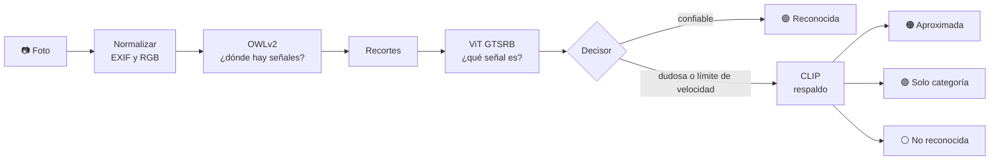
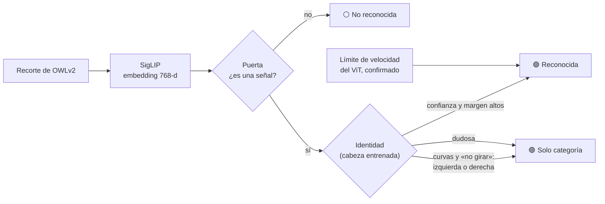
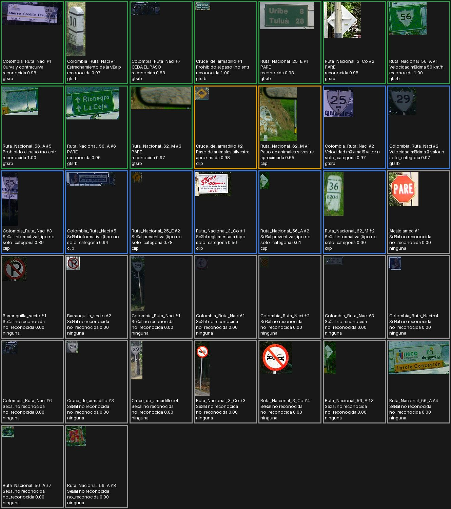
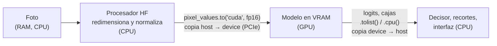

<div align="center">


# RoadVision

**Sube una foto de una vía y RoadVision encuentra sus señales de tránsito, las clasifica y te explica qué significan.**

[](https://www.python.org/)
[](https://pytorch.org/)
[](https://huggingface.co/docs/transformers)
[](https://streamlit.io/)
[](#cuda-en-la-aplicación)
<br>
[](LICENSE)
[](#pruebas)
[](https://github.com/DeimonBot/TrafficSigns/graphs/contributors)
[](https://github.com/DeimonBot/TrafficSigns/commits/main)


<sub>Demostración en CPU con una señal colombiana de paso de fauna. Foto: <a href="https://commons.wikimedia.org/wiki/File:Chucha_crossing_warning_sign.jpg">Germarquezm</a>, CC BY-SA 3.0.</sub>

</div>

---

## Contenido

- [¿Qué hace?](#qué-hace)
- [Capturas](#capturas)
- [Instalación paso a paso](#instalación-paso-a-paso)
- [Cómo se usa](#cómo-se-usa)
- [Estructura del proyecto](#estructura-del-proyecto)
- [Modelos](#modelos)
- [Ajustes que hicimos](#ajustes-que-hicimos)
- [CUDA en la aplicación](#cuda-en-la-aplicación)
- [Resultados y limitaciones](#resultados-y-limitaciones)
- [Licencia](#licencia)
- [Equipo](#equipo)
- [Créditos](#créditos)

## ¿Qué hace?

1. **Carga una foto** de una calle o carretera (JPG o PNG; corrige la rotación de las fotos de celular).
2. **Detecta** dónde hay señales de tránsito.
3. **Clasifica** cada señal y la asocia a un catálogo de señales colombianas.
4. **Explica** su significado en español.
5. **Resume** cuántas señales hay por categoría y **mide** el tiempo de cada etapa en CPU o GPU.

La regla de oro del proyecto: **es preferible decir "no la reconozco" que dar un nombre equivocado con seguridad.** Por eso cada señal sale con un estado:

| Estado | Qué significa |
|---|---|
| 🟢 **Reconocida** | El clasificador la identificó con confianza y tiene equivalente colombiano. |
| 🟠 **Aproximada** | La identificó el modelo de respaldo (CLIP); se muestra como aproximada. |
| 🟣 **Solo categoría** | Se sabe si es reglamentaria, preventiva o informativa, pero no cuál exactamente. |
| ⚪ **No reconocida** | No hay suficiente certeza para decir qué es. |



### Modo seguro (por defecto)

El clasificador alemán es muy seguro de sí mismo incluso cuando se equivoca: con fotos colombianas llega a llamar "PARE" a un escudo de ruta. Por eso, además del flujo anterior, la app incluye una **capa segura** que decide con un criterio más estricto (módulo `roadvision/capa_segura.py`):



- **Puerta y identidad:** dos cabezas de regresión logística entrenadas sobre embeddings de [SigLIP](https://huggingface.co/google/siglip-base-patch16-224) congelado, con ~220 recortes de fotos colombianas etiquetados por el equipo.
- **Guarda de dirección:** para curvas y «no girar» la app no da nombre (la izquierda y la derecha se confunden hasta el 28 %): solo la categoría.
- **Resultado medido** (validación cruzada por foto, 173 recortes de fotos colombianas): los nombres erróneos bajan de **49 a 0–1**, sin perder aciertos. El costo: nombra solo ~35 % de las señales del catálogo; en el resto dice «señal sin identificar».
- **Se activa solo** si están los artefactos (`data/capa_segura/`) y SigLIP descargado; si no, la app avisa y usa el modo clásico. Se puede forzar con `ROADVISION_MODO=clasico`.

## Capturas

| Resultado | Señales | Rendimiento |
|:---:|:---:|:---:|
|  |  |  |
| La señal queda marcada con el color de su categoría. | Cada señal con su recorte, estado, confianza y significado. | Tiempo total y por etapa (aquí en CPU). |

<p align="center">
  <br>
  <sub>Señales tipo europeo: PARE reconocido al 100 % y la flecha azul clasificada como reglamentaria. Foto: <a href="https://commons.wikimedia.org/wiki/File:GER_K%C3%B6ln,_C%C3%A4cilienstra%C3%9Fe_001.jpg">-wuppertaler</a>, CC BY 4.0.</sub>
</p>

### Un caso donde el modelo se equivoca

<p align="center">
  <br>
  <sub>Las 37 detecciones de 12 fotos de carretera colombianas con el <b>modo clásico</b>. Borde <b>verde</b> = «reconocida»; <b>azul</b> = solo categoría; <b>naranja</b> = aproximada; <b>gris</b> = no reconocida. Fotos de Wikimedia Commons (ver <a href="samples/ATRIBUCIONES.md">samples/ATRIBUCIONES.md</a>).</sub>
</p>

**Qué se ve:** de las 10 señales con borde verde («reconocida», confianza de 0,88 a 1,00) **ninguna resulta correcta**: 8 son vallas verdes, escudos de ruta y un mojón de kilómetro llamados *PARE*, *Velocidad máxima 50*, *Prohibido el paso* o *Estrechamiento de la vía*, y las otras 2 son recortes demasiado pequeños para confirmarlas. En cambio, señales colombianas reales (prohibido adelantar, prohibido estacionar, un PARE nítido) quedaron como «no reconocida».

**Qué concluimos:** el ViT se entrenó solo con señales alemanas y no sabe decir «esto no es una señal»: fuerza todo hacia una de sus 43 clases con mucha seguridad. Ajustar umbrales no lo arregla (las confianzas erróneas son de 0,95 a 1,00). Medido con fotos etiquetadas por el equipo, el modo clásico acierta solo en **~20–25 %** de los casos en que da un nombre. Esto motivó la capa segura (modo seguro), que reduce esos errores de 49 a 0–1.

## Instalación paso a paso

**Requisitos:** Python 3.11 o 3.12 (también funcionó con 3.13), Git y unos 5 GB libres (PyTorch, ~2,3 GB de modelos y datos). Una GPU NVIDIA es opcional: sin ella todo funciona en CPU, unas 14 veces más lento ([medición](#cuda-en-la-aplicación)).

> Consejo: clona el proyecto en una carpeta que no esté sincronizada con OneDrive, Google Drive o Dropbox.

**1. Clonar el repositorio**

```bash
git clone https://github.com/DeimonBot/TrafficSigns.git
cd TrafficSigns
```

**2. Crear y activar un entorno virtual**

```bash
python -m venv .venv
# Windows (PowerShell): .venv\Scripts\Activate.ps1
# Linux / macOS:        source .venv/bin/activate
```

**3. Instalar PyTorch** (va aparte porque depende de tu hardware)

- Sin GPU NVIDIA:

  ```bash
  pip install torch torchvision --index-url https://download.pytorch.org/whl/cpu
  ```

- Con GPU NVIDIA: elige tu variante de CUDA en el selector de [pytorch.org](https://pytorch.org/get-started/locally/) y ejecuta el comando que indica. Por ejemplo, con CUDA 12.8 (la que usamos, driver 621.14):

  ```bash
  pip install torch torchvision --index-url https://download.pytorch.org/whl/cu128
  ```

> `torch` no está en `requirements.txt` a propósito: pip instalaría la versión de CPU en Windows y taparía la de CUDA.

**4. Instalar el resto de dependencias** (listadas en [`requirements.txt`](requirements.txt))

```bash
pip install -r requirements.txt
```

**5. Descargar los modelos** (una sola vez; quedan en la caché de Hugging Face)

```bash
python scripts/download_models.py     # OWLv2, ViT GTSRB y CLIP (~1,5 GB)
python scripts/descargar_siglip.py    # SigLIP para el modo seguro (~0,8 GB)
```

**6. Comprobar la GPU** (opcional; termina con código 0 si PyTorch ve CUDA)

```bash
python scripts/check_gpu.py
```

Para el PC con GPU NVIDIA hay una guía completa de instalación y verificación, pensada para que la ejecute un asistente: [docs/guia-pc-nvidia.md](docs/guia-pc-nvidia.md).

## Cómo se usa

### Interfaz web (Streamlit)

```bash
streamlit run app.py
```

Se abre en `http://localhost:8501`. Sube una foto y revisa las pestañas:

- **Resultado:** la foto con las señales marcadas por color y un resumen por categoría.
- **Señales:** cada señal con su recorte, estado, confianza y significado.
- **Rendimiento:** dispositivo, tiempo total, tiempo por etapa, carga de cada modelo y el **uso del equipo** (GPU %, VRAM, temperatura, potencia, CPU y RAM de los análisis anteriores).
- **CPU vs GPU:** compara los tiempos en ambos dispositivos (solo con GPU NVIDIA).

En la barra lateral se ajustan los umbrales de detección y de clasificación, y se ve el **modo** activo (`seguro` o `clasico`). Cada análisis se registra una sola vez en `logs/metricas.csv` (ignorado por git) y se imprime una tabla de métricas en la terminal.

```bash
ROADVISION_MODO=clasico streamlit run app.py     # fuerza el pipeline original (PowerShell: $env:ROADVISION_MODO="clasico")
```

### Monitor en vivo y benchmark

```bash
streamlit run roadvision/dashboard/app_metrics.py            # GPU, VRAM, temperatura, potencia, CPU y RAM en vivo
python scripts/benchmark.py --carpeta samples --repeticiones 5 [--dispositivo cpu|cuda]
python scripts/benchmark.py --comparar-precision             # fp16 contra fp32 en la GPU
```

El benchmark excluye el calentamiento, reporta media, mediana y p95 por etapa y deja cada fila en `logs/metricas.csv` para el monitor.

### Etiquetar recortes

```bash
python scripts/extraer_recortes.py     # detecta con OWLv2 las señales de las fotos de datasets/co/fotos
streamlit run scripts/etiquetador.py   # etiquetas con un clic, deshacer y galería para corregir
```

Las fotos, recortes y etiquetas quedan en `datasets/`, que git ignora.

### Línea de comandos

```bash
python -m roadvision.cli foto.jpg [--dispositivo cpu|cuda] [--sin-fp16]
```

```text
Calentamiento (ms, no incluido en los tiempos): deteccion=13727.9 clasificacion=552.2 respaldo=1603.0
#1 PARE [reglamentaria] reconocida conf 1.00
    Detenga por completo el vehículo y avance solo cuando pueda hacerlo con seguridad, ...
Resumen: {'PARE': 1}
Tiempos (ms): total=12704 preproceso=3 deteccion=12208 clasificacion=493 respaldo=0
```

La primera inferencia de cada proceso es lenta (se inicializan los modelos y la GPU). Por eso la app y la CLI calientan los modelos antes de medir y reportan ese tiempo aparte.

### Evaluación del clasificador

```bash
python scripts/evaluate.py --nivel a [--limite N] [--dispositivo cpu|cuda] [--sin-fp16]
```

Mide la exactitud sobre el conjunto de prueba oficial de GTSRB (12 630 imágenes; se descarga la primera vez en `datasets/` o en la carpeta de la variable `ROADVISION_DATASETS`).

### Pruebas

```bash
pytest              # 145 pruebas rápidas, sin red ni modelos
pytest -m modelos   # 11 pruebas con los modelos reales (requieren los modelos descargados)
```

## Estructura del proyecto

```text
TrafficSigns/
├── app.py                      # Interfaz web en Streamlit
├── assets/logo.png
├── data/
│   ├── catalogo_senales.yaml   # Señales colombianas: nombre, categoría, significado, equivalencias
│   └── capa_segura/            # Cabezas entrenadas sobre SigLIP (cabezas.npz) y su meta.json
├── roadvision/                 # Núcleo (sin interfaz)
│   ├── contracts.py            # Tipos compartidos: Resultado, Senal, protocolos
│   ├── config.py               # Modelos, umbrales y rutas
│   ├── imaging.py · cajas.py   # Fotos (EXIF, RGB, recortes) y cajas (IoU, cajas anidadas)
│   ├── device.py · timing.py   # CPU/GPU, fp16 y cronómetro por etapa
│   ├── detector.py             # OWLv2
│   ├── classifier.py           # ViT GTSRB
│   ├── fallback.py             # CLIP
│   ├── catalog.py              # Carga y valida el catálogo
│   ├── decision.py             # Reglas para no dar nombres equivocados
│   ├── pipeline.py             # analizar(foto) -> Resultado
│   ├── capa_segura.py          # Modo seguro: SigLIP + puerta + identidad (PipelineSeguro)
│   ├── metrics.py              # Muestreo de GPU/VRAM/CPU/RAM, CSV y reportes
│   ├── dashboard/              # Monitor en vivo (Streamlit)
│   ├── etiquetado.py           # Lógica de la herramienta de etiquetado
│   ├── evaluacion.py           # Métricas de evaluación
│   └── cli.py                  # python -m roadvision.cli
├── scripts/                    # download_models.py, descargar_siglip.py, check_gpu.py, evaluate.py,
│                               # benchmark.py, stress_load.py, extraer_recortes.py, etiquetador.py
├── samples/                    # Fotos de prueba (Colombia y Alemania) con su atribución
├── tests/                      # Pruebas (pytest)
├── docs/
│   ├── guia-pc-nvidia.md       # Instalación y pruebas en el PC con GPU
│   ├── evidencia-cuda/         # Salidas de torch, nvidia-smi y benchmarks CPU/GPU
│   ├── img/                    # Capturas del README
│   └── superpowers/            # Diseño (specs/) y plan de implementación (plans/)
├── requirements.txt
├── pytest.ini
└── LICENSE
```

## Modelos

RoadVision combina **cuatro** modelos preentrenados de Hugging Face, cada uno con un papel distinto. Los tres primeros forman el pipeline clásico; el cuarto ([SigLIP](#capa-segura--siglip)) alimenta el modo seguro:

| | Detector | Clasificador | Respaldo |
|---|---|---|---|
| **Modelo** | [`google/owlv2-base-patch16-ensemble`](https://huggingface.co/google/owlv2-base-patch16-ensemble) | [`kelvinandreas/vit-traffic-sign-GTSRB`](https://huggingface.co/kelvinandreas/vit-traffic-sign-GTSRB) | [`openai/clip-vit-base-patch32`](https://huggingface.co/openai/clip-vit-base-patch32) |
| **Tarea** | Detección de objetos por texto (*zero-shot*) | Clasificación de imágenes (43 clases) | Clasificación por texto (*zero-shot*) |
| **Arquitectura** | OWLv2: ViT-B/16 (12 capas, 768 dim.) + codificador de texto CLIP; entrada 960×960 | ViT-Base/16 (12 capas, 768 dim.); entrada 224×224 | CLIP: ViT-B/32 (imagen) + Transformer (texto); entrada 224×224 |
| **Parámetros** | **155,0 M** | **85,8 M** | **151,3 M** |
| **Publicado por** | Google | Kelvin Andreas (ajustado desde `google/vit-base-patch16-224-in21k`, de Google) | OpenAI |
| **Datos de entrenamiento** | Imágenes web con pseudoetiquetas (WebLI) | GTSRB, señales alemanas | 400 M pares imagen-texto de internet |
| **Licencia** | Apache-2.0 | MIT (modelo base: Apache-2.0) | Sin licencia en la ficha; el código oficial (`openai/CLIP`) es MIT |
| **Exactitud publicada** | — | 0,9846 en GTSRB (según su ficha) | — |

Los parámetros se contaron cargando cada modelo con `transformers` 5.22.2. Los tres del pipeline clásico suman unos **392 M**: ~0,8 GB en fp16 (medido en la GPU: 303 + 171 + 296 MB de VRAM) o ~1,6 GB en fp32. SigLIP añade 93 M (185 MB de VRAM en fp16).

### Detector — OWLv2

- **Qué hace:** encuentra objetos a partir de una descripción en texto. RoadVision le pregunta por `"a traffic sign"` y `"a road sign"`, y solo le pide *dónde* están; no lo usa para saber *cuál* es la señal.
- **Restricciones de uso:** Apache-2.0 permite uso comercial y académico. La ficha lo presenta como un resultado de investigación pensado para investigadores.
- **Por qué lo elegimos:** en Hugging Face revisamos varios detectores YOLO de señales:
  - Estaban entrenados con señales de India, Estados Unidos o Dinamarca, que solo ven las clases de su país.
  - Uno tenía un *recall* de 0,60 en su propia validación.
  - Varios no documentaban sus datos.
  - Además, Ultralytics usa licencia AGPL-3.0.

  OWLv2 no depende de un país: encuentra señales redondas, octogonales o en rombo amarillo sin entrenarlo.

### Clasificador — ViT GTSRB

- **Qué hace:** recibe el recorte de cada señal y elige una de las 43 clases del *German Traffic Sign Recognition Benchmark*. Por ejemplo `"Stop"` o `"Speed limit (50km/h)"`.
- **Restricciones de uso:** MIT, sin restricciones relevantes. Solo conoce señales alemanas, así que un catálogo traduce cada clase a su equivalente colombiano. Las 20 clases que no existen en Colombia, como *Priority road*, se descartan.
- **Por qué lo elegimos:**
  - `bazyl/gtsrb-model` anuncia 99,93 %, pero se evaluó con unas 5 900 imágenes, que equivalen al 15 % del conjunto de entrenamiento y no al test oficial. Probablemente es una partición del propio entrenamiento, que tiene muchas fotos casi idénticas de la misma señal, así que la cifra queda inflada. Además trae una etiqueta vacía.
  - `Shijunqiang/TrafficSignClassification` son puntos de control de investigación sin forma estándar de cargarlos.
  - El de Kelvin Andreas tiene etiquetas con nombre, ficha documentada, demo pública y licencia MIT.

### Respaldo — CLIP

- **Qué hace:** compara un recorte con descripciones en inglés y dice cuál se parece más. Cumple dos funciones:
  - verificar el número de los límites de velocidad, porque GTSRB no tiene 40 ni 90 km/h;
  - aproximar señales colombianas que GTSRB no conoce, como las preventivas en rombo amarillo.
- **Restricciones de uso:** la ficha de OpenAI lo define como un resultado de investigación. Dice que cualquier despliegue del modelo, comercial o no, está fuera de alcance, que no se recomienda para vigilancia ni reconocimiento facial y que solo se evaluó en inglés. RoadVision es un proyecto académico no desplegado y usa las descripciones en inglés.
- **Por qué lo elegimos:** es la forma más simple de cubrir señales que ningún modelo preentrenado conoce sin entrenar nada, y la versión B/32 es liviana. Usamos CLIP en lugar de una segunda versión de OWLv2 porque aquí solo hace falta comparar un recorte con textos, no localizar objetos.

### Capa segura — SigLIP

| | |
|---|---|
| **Modelo** | [`google/siglip-base-patch16-224`](https://huggingface.co/google/siglip-base-patch16-224) |
| **Qué hace** | Aprende a emparejar imágenes y textos como CLIP, pero con una pérdida sigmoide en vez de softmax. RoadVision no usa el texto: solo extrae un **embedding de 768 números** del recorte. |
| **Arquitectura** | ViT-B/16 para la imagen + Transformer para el texto; entrada 224×224 |
| **Parámetros** | 203,2 M en total; **92,9 M** la torre de visión, que es la única que cargamos |
| **Publicado por** | Google (Zhai et al., *Sigmoid Loss for Language Image Pre-Training*). La ficha la escribió el equipo de Hugging Face, no el de Google. |
| **Datos de entrenamiento** | WebLI, pares imagen-texto en inglés; 16 chips TPU-v4 durante 3 días |
| **Licencia** | Apache-2.0 |
| **Restricciones de uso** | La ficha no declara usos prohibidos; lo presenta para clasificación *zero-shot* y búsqueda imagen-texto. |

- **Por qué lo elegimos:** no fue por reputación, sino por medición. Comparamos seis extractores de características (CLIP B/32 y B/16, DINOv2 pequeño y base, el propio ViT GTSRB y SigLIP) con los recortes colombianos etiquetados, en validación cruzada por foto: SigLIP B/16 acertó la identidad en **70 %** de los casos frente a **47 %** de CLIP B/32, y separó mejor «es una señal / no lo es» (AUC 0,945 contra 0,894). Con ~50 señales reales los intervalos son amplios y probamos 24 configuraciones sobre los mismos datos, así que el 70 % es una cota optimista.
- **Cómo lo usamos:** congelado, en fp16, solo la torre de visión. Encima entrenamos dos cabezas de regresión logística (ver [Ajustes](#ajustes-que-hicimos)).

## Ajustes que hicimos

**Fine-tuning de los modelos: no hicimos.** Ningún encoder se reentrenó. No existe un conjunto de datos público de señales colombianas (el más parecido, el de la Universidad de las Fuerzas Armadas ESPE de Ecuador, no pudimos verificarlo), y reentrenar un modelo con ~60 señales reales repartidas en 18 clases (la mayoría con 1 a 4 ejemplos) es muy poco para ajustarlo con garantías.

**Lo que sí entrenamos: cabezas livianas.** Sobre el SigLIP congelado entrenamos dos regresiones logísticas (puerta «¿es una señal?» e identidad de la señal) con ~220 recortes etiquetados por el equipo. Los umbrales de la política de nombre se eligieron con **validación cruzada por foto**, sin ver nunca la foto evaluada. Entrenar esas cabezas toma segundos y no toca los pesos de los modelos. También probamos añadir miles de recortes sintéticos generados a partir de los pictogramas oficiales del Manual de Señalización Vial (dominio público): mejoraron la identidad bruta, pero no de forma distinguible del ruido en los nombres seguros, así que la versión incluida usa solo recortes reales.

**Cuantización: solo media precisión (fp16) en GPU.**
- Con CUDA, los modelos corren en fp16 automáticamente; en CPU usan fp32. La opción `--sin-fp16` fuerza fp32.
- Las probabilidades se calculan siempre en fp32.
- No usamos INT8: los modelos caben de sobra en la memoria de una GPU de consumo (~0,8 GB en fp16; ~1 GB con SigLIP), y bajar a 8 bits arriesga exactitud sin una necesidad medida.
- **Medido en la RTX 3050 (4 GB):** fp16 es **~3 veces más rápido** que fp32 (mediana por foto 263 ms contra 791 ms) y usa la mitad de VRAM (pico de PyTorch 871 MB contra 1.686 MB). `python scripts/benchmark.py --comparar-precision` lo reproduce. Las detecciones cambian poco (37 contra 39 señales en 12 fotos), pero no medimos cuál precisión acierta más.

**Parámetros de inferencia** (en [`roadvision/config.py`](roadvision/config.py); los dos primeros se pueden cambiar desde la app):

| Parámetro | Valor | Para qué |
|---|---|---|
| Umbral de detección (OWLv2) | 0,15 | Descarta cajas con puntaje bajo. |
| Umbral del clasificador (ViT) | 0,80 | Por debajo, la señal pasa al respaldo CLIP. |
| Umbral de señal en CLIP | 0,50 | Mínimo para dar una señal como "aproximada". |
| Umbral de categoría en CLIP | 0,50 | Mínimo para dar "solo categoría". |
| Consultas del detector | `a traffic sign`, `a road sign` | Qué busca OWLv2. |
| Margen del recorte | 10 % | Contexto alrededor de cada señal. |
| Tamaño mínimo de caja | 20 px | Ignora señales demasiado pequeñas. |
| IoU para duplicados | 0,5 | Une la misma señal detectada por las dos consultas. |
| Contención de cajas | 0,8 | Si una caja contiene a otra más pequeña (señal + poste), se queda la pequeña. Sin esto, la misma señal salía duplicada con nombres contradictorios. |
| Capa segura: puerta / identidad / margen | 0,95 / 0,6 / 0,6 | Mínimos para dar un nombre; salen de validación cruzada. Viven en `data/capa_segura/meta.json`. |

Además, los límites de velocidad se verifican con CLIP antes de darlos por reconocidos, y CLIP puede responder "no es una señal".

## CUDA en la aplicación

**CUDA es la plataforma de NVIDIA para ejecutar cálculo general en la GPU.** PyTorch la usa por debajo: cuando un tensor y un modelo están en `"cuda"`, cada multiplicación de matrices de los Transformers se lanza como un *kernel* que corre en miles de núcleos en paralelo. La app elige el dispositivo así (`roadvision/device.py`):

```python
import torch
device = "cuda" if torch.cuda.is_available() else "cpu"   # fp16 en GPU, fp32 en CPU
```

### Qué corre en la GPU (*device*) y qué en el CPU (*host*)

| En la **GPU** | En el **CPU** |
|---|---|
| Cálculo de **OWLv2** (detector), **ViT GTSRB** (clasificador), **CLIP** (respaldo) y **SigLIP** (modo seguro), en **fp16** | Abrir y decodificar la foto, corregir la rotación EXIF, convertir a RGB |
| Softmax de las probabilidades (en fp32) | Los procesadores de imagen de Hugging Face: redimensionar y normalizar a tensores |
| | Filtrar cajas, recortar, reglas de decisión, puerta e identidad de la capa segura, dibujar, interfaz Streamlit y CSV |

### Cómo viajan los datos entre los dos



1. **Una sola vez, al arrancar:** los pesos se copian a la VRAM con `.to("cuda", dtype=float16)` (`@st.cache_resource` evita recargarlos en cada clic). Quedan residentes: 303 MB el detector, 171 MB el clasificador y 296 MB CLIP.
2. **En cada foto:** el CPU prepara el tensor; se copia a la GPU; el modelo calcula; solo los resultados pequeños (cajas y probabilidades) vuelven al CPU. Los recortes se clasifican en **un solo lote** para copiar menos veces.
3. **Para medir bien:** las llamadas a CUDA son asíncronas (el CPU sigue sin esperar), así que el cronómetro llama a `torch.cuda.synchronize()` antes de leer el reloj. Sin eso, los tiempos de GPU saldrían falsamente bajos.

### Evidencia de que se usó la GPU

Salida de `torch.cuda.is_available()` ([`docs/evidencia-cuda/torch.txt`](docs/evidencia-cuda/torch.txt)):

```text
torch 2.11.0+cu128 | CUDA build 12.8
torch.cuda.is_available(): True
GPU: NVIDIA GeForce RTX 3050 Laptop GPU | VRAM total: 4.0 GB | capability (8, 6)
```

`nvidia-smi` **durante la inferencia** ([completo](docs/evidencia-cuda/nvidia-smi_durante_inferencia.txt)): 68 % de uso de la GPU, 2.825 MiB de 4.096 MiB, 39 W de 64 W y 85 °C mientras corría el benchmark.

```text
| N/A   85C    P0             39W /   64W |    2825MiB /   4096MiB |     68%      Default |
```

> La VRAM de `nvidia-smi` es la de **todo el dispositivo** (incluye el navegador y otros programas). La de nuestro proceso medida por PyTorch fue de **871 MB** de pico.

### Comparación CPU contra GPU con la misma entrada

Mismas 6 fotos de `samples/colombia_extra`, pipeline clásico, mediana por foto (GPU: fp16, 25 repeticiones; CPU: fp32, 2 repeticiones; sin calentamiento). Reproducible con `python scripts/benchmark.py --carpeta samples/colombia_extra --dispositivo cuda|cpu` ([GPU](docs/evidencia-cuda/benchmark_gpu.txt), [CPU](docs/evidencia-cuda/benchmark_cpu.txt)).

| Etapa | CPU (fp32) | GPU (fp16) | Aceleración |
|---|---:|---:|---:|
| **Total** | **4.287 ms** | **308 ms** | **13,9×** |
| Detección (OWLv2) | 3.667 ms | 224 ms | 16,4× |
| Clasificación (ViT) | 222 ms | 20 ms | 11,4× |
| Respaldo (CLIP) | 347 ms | 62 ms | 5,6× |
| Preproceso (CPU en ambos) | 3,4 ms | 3,0 ms | ≈ 1× |
| Imágenes por segundo (equivalente) | 0,23 | 3,25 | |

- **Lo que se ve:** la GPU acelera sobre todo el detector, que es el modelo más grande y procesa una imagen de 960×960. El preproceso no cambia porque corre en el CPU en los dos casos.
- **Consumo en la GPU:** pico de uso 100 %, ~42 W de potencia media y hasta **89 °C** en carga sostenida (es una laptop: conviene ventilarla).
- **En la app:** la pestaña **CPU vs GPU** hace esta misma comparación con la foto que subas.
- **Limitaciones:** es una sola máquina y 6 fotos; la comparación de CPU usa solo 2 repeticiones por foto; y las filas de clasificación y respaldo promedian también las fotos sin recortes, que cuentan 0 ms.

## Resultados y limitaciones

**Medido** (RTX 3050 Laptop 4 GB, driver 621.14, PyTorch 2.11 + CUDA 12.8):
- **Exactitud del clasificador** en el test oficial de GTSRB completo (12.630 imágenes): **0,9537**, a ~205 imágenes por segundo. La ficha del modelo anuncia 0,9846, sin decir con qué partición; no pudimos reproducirlo.
- **Tiempo por foto:** ~**310 ms** en GPU (fp16) contra ~**4,3 s** en CPU (fp32): [13,9× más rápido](#cuda-en-la-aplicación). El modo seguro añade unos 30 ms y 186 MB de VRAM.
- **Precisión de los nombres en fotos colombianas** (validación cruzada por foto, ~170 recortes etiquetados por el equipo). Es el resultado más importante:

| Sistema | Nombres correctos | Nombres erróneos |
|---|:---:|:---:|
| Clásico (OWLv2 + ViT + CLIP) | 16 | **49** |
| **Modo seguro** | 16 | **0** |

  La mejora en errores es sólida (intervalo del 95 %: −66 a −34 errores); **el modo seguro no gana aciertos**: nombra solo ~35 % de las señales del catálogo y calla en clases con pocos ejemplos.
- **Pruebas:** 145 rápidas y 11 con los modelos reales, todas en verde.

**Limitaciones conocidas** (modo clásico, y lo que el modo seguro resuelve o no):
- **Escudos de ruta, vallas y letreros confundidos con señales** (modo clásico). El escudo de la Ruta 25 salió como "Curva y contracurva" (0,98); en otras fotos aparecieron "Velocidad máxima 50" y "PARE" donde no había esas señales. *El modo seguro lo corrige* (ver la [hoja de casos](#un-caso-donde-el-modelo-se-equivoca)).
- **El "STOP" alemán no es el "PARE" colombiano.** En el modo clásico un PARE colombiano real quedó como «no reconocida». El modo seguro sí lo reconoce, pero ya **no nombra los STOP alemanes**: es un cambio de dominio y para Colombia es aceptable.
- **Izquierda y derecha.** Las curvas y los «no girar» se confunden hasta el 28 % entre sí, y CLIP no distingue izquierda de derecha. Por eso el modo seguro no nombra esas señales y da solo la categoría.
- **El catálogo tiene huecos.** Faltan *prohibido bicicletas*, *prohibido motos*, *fin de prohibición de adelantar*, el *chevron* de curva y la *pendiente descendente*. Sin esas clases la app puede dar un nombre de **significado contrario**: el cartel de *prohibido bicicletas* salió como «Cruce de ciclistas» (0,79), una advertencia en lugar de una prohibición.
- **Cobertura baja.** Con unas 60 señales reales etiquetadas (la mayoría de las 18 clases con 1 a 4 ejemplos), el modo seguro nombra ~35 % de las del catálogo. Más fotos etiquetadas es lo único que lo sube. Los intervalos de las cifras son amplios y los umbrales de la política son inestables entre pliegues.
- **Detecciones inútiles.** OWLv2 detecta cualquier cartel: alrededor del 60 % de sus detecciones en nuestras fotos no eran señales de tránsito. La puerta de la capa segura las filtra, pero a veces recorta mal (una señal con su poste, o un trozo de triángulo).
- **Fotos de prueba sesgadas.** Casi todas son carreteras nacionales colombianas de Wikimedia, no calles urbanas.

Los nombres y significados del catálogo están pendientes de revisión contra el Manual de Señalización Vial de Colombia (2015).

## Licencia

El código de RoadVision se publica bajo la [licencia MIT](LICENSE).

**¿Es compatible con los modelos?** Sí:
- **Los pesos no se redistribuyen.** No están en este repositorio: cada usuario los descarga desde Hugging Face con `scripts/download_models.py` y `scripts/descargar_siglip.py`, bajo la licencia de cada modelo. Lo único que se versiona son las **cabezas** que entrenamos (136 KB, `data/capa_segura/`), que son nuestras.
- **Las licencias son compatibles con MIT.** Apache-2.0 (OWLv2, SigLIP) y MIT (ViT GTSRB, código de CLIP) son permisivas y permiten uso, modificación y redistribución con atribución.
- **Respetamos el uso previsto de CLIP.** Su ficha lo limita a investigación, y RoadVision es un proyecto académico que no se despliega como servicio.

| Componente | Licencia |
|---|---|
| RoadVision (este repositorio) | MIT |
| OWLv2 | Apache-2.0 |
| SigLIP | Apache-2.0 |
| ViT GTSRB / modelo base ViT | MIT / Apache-2.0 |
| CLIP | Código MIT; ficha de uso para investigación |
| PyTorch | BSD-3-Clause |
| Transformers, Streamlit | Apache-2.0 |
| GTSRB (datos de evaluación) | Términos del benchmark (INI, Ruhr-Universität Bochum) |
| Fotos de las capturas | CC BY-SA 3.0 y CC BY 4.0 (ver [Créditos](#créditos)) |

## Equipo

| Integrante | Aporte |
|---|---|
| [@DidierParody](https://github.com/DidierParody) | Investigación y diseño, núcleo de modelos (`roadvision/`), catálogo de señales, evaluación y documentación. |
| [@DeimonBot](https://github.com/DeimonBot) | Interfaz web en Streamlit, logo y estilo visual. |
| [@xaiclon](https://github.com/xaiclon) | Métricas de uso de GPU/CPU, monitor en vivo y benchmark; herramienta de etiquetado de recortes; corrección de cajas duplicadas; evaluación con fotos colombianas y capa de reconocimiento segura con SigLIP. |

<a href="https://github.com/DeimonBot/TrafficSigns/graphs/contributors">
  
</a>

## Créditos

- **Modelos:**
  - [OWLv2](https://huggingface.co/google/owlv2-base-patch16-ensemble): Minderer et al., Google, 2023.
  - [ViT GTSRB](https://huggingface.co/kelvinandreas/vit-traffic-sign-GTSRB): Kelvin Andreas.
  - [CLIP](https://huggingface.co/openai/clip-vit-base-patch32): Radford et al., OpenAI, 2021.
  - [SigLIP](https://huggingface.co/google/siglip-base-patch16-224): Zhai et al., Google, 2023.
- **Datos:** German Traffic Sign Recognition Benchmark (GTSRB), Institut für Neuroinformatik, Ruhr-Universität Bochum.
- **Fotos de prueba** (`samples/`, hoja de casos límite y recortes de entrenamiento): Wikimedia Commons, con autor y licencia de cada una en [`samples/ATRIBUCIONES.md`](samples/ATRIBUCIONES.md). Los pictogramas del Manual de Señalización Vial que usamos en los experimentos están marcados como dominio público en Commons.
- **Fotos de las capturas** (Wikimedia Commons; las capturas que las contienen se distribuyen bajo la misma licencia):
  - [Chucha crossing warning sign](https://commons.wikimedia.org/wiki/File:Chucha_crossing_warning_sign.jpg), Germarquezm, CC BY-SA 3.0.
  - [GER Köln, Cäcilienstraße 001](https://commons.wikimedia.org/wiki/File:GER_K%C3%B6ln,_C%C3%A4cilienstra%C3%9Fe_001.jpg), -wuppertaler, CC BY 4.0.
- **Referencia de señales:** Manual de Señalización Vial de Colombia (Ministerio de Transporte, Resolución 1885 de 2015).

---

<div align="center"><sub>Hecho para un proyecto académico de visión por computador · 2026</sub></div>
